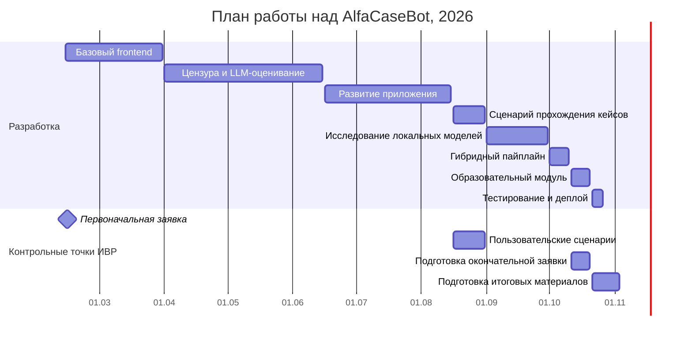

# Окончательная заявка на IT-проект AlfaCaseBot

**Автор ИВР:** Олейникова Дарья Евгеньевна, 11И7, Лицей НИУ ВШЭ  
**Название ИВР:** [Alfa-ИВР] Кейс 5 - ИИ-тренажёр с бизнес-кейсами  
**Формат:** групповой проект, индивидуальные зоны ответственности участников  
**Заказчик кейса:** Альфа-Банк  
**Рабочий продукт:** [alfacasebot.it-networking.ru](https://alfacasebot.it-networking.ru/)  
**Репозиторий frontend и ML:** [d-oley/AlfaCaseBot](https://github.com/d-oley/AlfaCaseBot)

## 1. Описание проекта и распределение ответственности

AlfaCaseBot - это веб-тренажёр для практики решения бизнес-кейсов. Пользователь выбирает задачу, предлагает свой вариант решения в чате с интеллектуальным помощником и получает оценку по нескольким критериям и рекомендации. Цель обратной связи - помочь улучшить рассуждение, а не предоставить готовое решение. История попыток, результаты и прогресс сохраняются в личном кабинете.

Проект мы выполняем командой, при этом у каждого участника своя ИВР. Я отвечаю за пользовательский интерфейс на Vue.js, разработку и исследование ML-моделей, Python-микросервис оценки, интеграцию frontend и ML-части с backend и развёртывание этих компонентов. Иван Абанов разрабатывает backend на Java, API и работу с данными. Анна Степанова отвечает за содержание бизнес-кейсов и критерии их оценки, а Виктория Диброва и Алина Макарова занимаются исследованиями целевой аудитории и аналогов. При согласовании сценариев, структуры данных и качества обратной связи мы работаем совместно. Консультации по проекту проводит представитель Альфа-Банка Дарья Олеговна Майдибор.

AlfaCaseBot разработан по кейсу Альфа-Банка в рамках лицейского проекта и не является официальным сервисом банка.

## 2. Проблемное поле

Бизнес-кейсы используют на учебных занятиях, кейс-чемпионатах и при подготовке к стажировкам. Работа с ними требует не только знания терминов, но и умения выделять проблему, обосновывать предложения и учитывать ограничения. Начинающим участникам сложно понять, насколько их решение полно и убедительно. Если эксперт не может проверить ответ сразу, у пользователя нет возможности быстро доработать его и попробовать ещё раз.

Ещё одна трудность заключается в том, что самостоятельная проверка не даёт понятных критериев: человек может считать предложенный вариант хорошим, но не замечать логические пробелы, спорные факты или недостаточно проработанный план. Текстовые условия также бывают объёмными, поэтому для работы с ними нужны удобный интерфейс, история попыток и наглядное представление результата.

Исследованием аудитории занималась Виктория Диброва при участии Алины Макаровой. В материалах опроса 62 респондентов отмечен интерес к тренажёру с обратной связью: около трёх четвертей опрошенных выбрали положительный ответ на вопрос об интересе к такому продукту. Многие участники почти не имели опыта решения кейсов. Среди желаемых функций особенно выделялся подробный разбор ошибок, а не только балл или игровые награды. Полные исходные материалы исследования, методика и ответы респондентов находятся у Виктории Дибровой. Полученные результаты использовались нами при обсуждении требований к продукту.

Для решения этой проблемы мы создаём сервис, в котором можно последовательно работать над кейсом, отправлять несколько вариантов ответа, получать оценку и обратную связь, а затем видеть собственный прогресс. Автоматическая проверка при этом рассматривается как учебный инструмент: она не гарантирует экспертную точность и не заменяет оценку преподавателя.

## 3. Заказчик и целевая аудитория

Заказчиком учебного кейса выступает Альфа-Банк. Основные потенциальные пользователи платформы:

1. **Старшеклассники 14-18 лет**, которые интересуются экономикой, управлением, предпринимательством, готовятся к поступлению на профильные программы или участвуют в кейс-чемпионатах. Им нужны понятный старт, задачи разной сложности и поддерживающая обратная связь.
2. **Студенты примерно 18-22 лет** экономических, управленческих и смежных направлений. Они могут использовать тренажёр для практики анализа бизнес-ситуаций, подготовки к соревнованиям и собеседованиям.
3. **Начинающие специалисты**, которым важно тренировать аргументацию и поиск решений для нестандартных задач. Для них особенно значимы реалистичность кейсов и прозрачные критерии оценки.

Дополнительная аудитория - преподаватели и руководители бизнес-кружков, которые могут использовать готовые кейсы и теоретические материалы в обучении. Отдельный преподавательский кабинет в окончательный функционал не входит.

## 4. Аппаратные и программные требования

Для пользователя AlfaCaseBot работает как веб-приложение. Устанавливать отдельную программу не нужно. Требуется устройство с интернетом, браузером с поддержкой JavaScript и разрешёнными cookie, поскольку авторизация выполняется через серверную сессию.

**Ориентир для проверки веб-версии:** компьютер или ноутбук с двухъядерным процессором, 4 ГБ оперативной памяти, встроенной или дискретной видеокартой, доступным местом для браузерного кеша; Windows 10 или новее, актуальные версии macOS или Linux и современный браузер Chrome, Firefox или Edge. Интерфейс также адаптирован для смартфонов с современными версиями Android или iOS и мобильными браузерами. Непрерывное подключение к интернету необходимо для авторизации, загрузки данных и оценивания. Перечисленная конфигурация является ориентиром для демонстрации, а не результатом отдельного исследования минимальных системных требований или гарантией совместимости со всеми версиями ОС и браузеров.

На серверной стороне используются Linux, Docker, Java-приложение, PostgreSQL, веб-сервер и отдельный Python ML-сервис. Для нейросетевого оценивания необходимы сохранённые веса RuBERT Tiny2, а для внешних запросов - настроенные ключи соответствующих сервисов. Основные компоненты развёрнуты на сервере под Ubuntu 24.04; объём оперативной памяти сервера составляет 8 ГБ.

## 5. Функциональные требования

Ниже зафиксирован окончательный набор пользовательских возможностей. Подробные шаги, условия и обработка ошибок вынесены в [пользовательские сценарии](https://github.com/d-oley/AlfaCaseBot/blob/master/user_scripts.md).

1. **Работа с учётной записью.** Пользователь может зарегистрироваться, подтвердить аккаунт по электронной почте или через Telegram, войти, выйти и изменить данные профиля.
2. **Настройка предпочтений.** Пользователь может указать интересующие темы и сложность кейсов; система сохраняет эти настройки и предлагает подходящий кейс.
3. **Выбор задания.** Пользователь может просматривать каталог опубликованных кейсов и отбирать их по тематике и сложности.
4. **Просмотр условий.** Пользователь может открыть карточку кейса, прочитать описание, увидеть связанные сведения и открыть PDF с условием, если он приложен.
5. **Избранное и пользовательские оценки.** Пользователь может сохранять интересные кейсы в избранное и оценивать их по пятизвёздочной шкале.
6. **Решение кейса и автоматическая обратная связь.** Пользователь может отправлять текстовые версии решения в чат, получать оценку от 0 до 100 и рекомендации по улучшению. Это ключевая функция продукта.
7. **Завершение кейса и сравнение с эталоном.** Пользователь может завершить решение и после завершения посмотреть эталон, если он добавлен администратором. Завершённый кейс нельзя начать заново.
8. **Теоретические материалы и тесты.** Пользователь может изучать материалы по кейсу, проходить связанные тесты и видеть сохранённые результаты и число попыток.
9. **Просмотр и восстановление прогресса.** Пользователь может посмотреть в личном кабинете свои решённые кейсы, лучшие баллы и историю результатов. Данные хранятся на сервере и восстанавливаются после повторного входа с другого устройства.
10. **Рейтинги и достижения.** Пользователь может видеть своё положение в общем рейтинге, результаты лучших участников по отдельному кейсу и полученные достижения.
11. **Модерация сообщений.** Система проверяет сообщения перед оцениванием, отклоняет недопустимые запросы и применяет предусмотренные правила предупреждений и блокировок.
12. **Администрирование кейсов и тегов.** Администратор может создавать и изменять кейсы, управлять их публикацией, файлами, эталонными решениями и тегами.
13. **Администрирование образовательных материалов и пользователей.** Администратор может создавать теоретические блоки и тесты, управлять пользователями и просматривать отправленные решения.

В чат не включены отдельная кнопка для получения готового ответа и свободный доступ к эталонному решению до завершения кейса. Пользователю показываются итоговый балл и текстовый отзыв. Подробные баллы по всем пяти критериям в интерфейсе отдельно не выводятся.

## 6. Похожие и аналогичные продукты

В ходе анализа мы рассмотрели решения, в которых есть отдельные элементы требуемого функционала, но другой основной сценарий использования.

**[Яндекс CodeRun](https://coderun.yandex.ru/)** позволяет практиковаться в решении задач и получать автоматическую проверку, однако ориентирован прежде всего на программирование. Проверка развёрнутой бизнес-идеи по критериям логики, эффективности и оригинальности не является его основным сценарием.

**[Stepik](https://stepik.org/)** предоставляет курсы, теорию и автоматическую проверку учебных заданий. Для нашего случая ограничение заключается в том, что типовая проверка тестов и коротких ответов не заменяет диалоговую работу над открытым бизнес-кейсом с несколькими попытками улучшить собственное решение.

**[ChatGPT](https://chatgpt.com/)** может обсуждать бизнес-задачи и помогать с текстами, но обычный чат сам по себе не предоставляет наш заранее организованный каталог кейсов, связанные эталонные решения, правила прохождения, накопление результатов по кейсам и пользовательские рейтинги.

**[CaseSim](https://casesim.ru/)** относится к сервисам практики кейсов. При проектировании AlfaCaseBot для нас было важно дополнить сам факт решения задачи единым учебным маршрутом: сохранением нескольких попыток, персональными рекомендациями, теоретическим модулем и анализом текста с помощью собственного ML-сервиса. Это различие не означает, что у аналога отсутствуют вообще все перечисленные возможности: сравниваются прежде всего акценты и сценарии использования.

Основная особенность AlfaCaseBot - объединение каталога кейсов, диалога с ИИ, автоматической оценки по пяти критериям, накопления результатов и образовательных материалов в одном веб-приложении.

## 7. Инструменты разработки, архитектура и база данных

**Frontend.** Я разработала интерфейс на Vue 3 с Vue Router, JavaScript и CSS. Он включает публичную часть, личный кабинет, каталог, чат, образовательные страницы и административную панель. Для тестирования интерфейса предусмотрен mock-режим. Пользовательские запросы направляются к серверным API; сервер остаётся источником основных данных о пользователе и его результатах.

**Backend и хранение.** Иван разработал backend на Java и Spring Boot. Для структурированных данных используется PostgreSQL: она позволяет хранить пользователей, кейсы, теги, решения, результаты, достижения и связи между ними. Для вспомогательных задач в инфраструктуре также используются Redis и MinIO. Самостоятельно реализовывать backend в рамках моей зоны ответственности не требовалось, но интерфейс и ML-сервис я согласовывала с его API.

**ML.** Я разработала Python-сервис на FastAPI. Перед оценкой сообщение проходит языковую проверку и модерацию на основе модели с TF-IDF-признаками и логистической регрессией, обученной с использованием scikit-learn. Затем система оценивает решение по пяти критериям: фактологическая корректность (20%), оригинальность (25%), эффективность (25%), логика (15%) и полнота (15%). Итоговая оценка находится в диапазоне от 0 до 100.

Первая версия оценивания использовала большую языковую модель для всех критериев. После исследования локальных подходов я реализовала гибридный вариант: RuBERT Tiny2 оценивает эффективность, логику и полноту, а LLM используется для фактологической проверки, сравнения с эталоном по оригинальности и создания текстовой обратной связи. Эталон хранится на серверной стороне и не передаётся пользователю до разрешённого момента. В проекте сохранён и вариант полностью LLM-оценивания для сравнения подходов.

В рамках исследования я сравнила модели TF-IDF + Ridge, модели на эмбеддингах с Ridge и CatBoost, RuBERT Tiny2 и RuBERT-base. В сохранённых экспериментах RuBERT Tiny2 показал MAE 3,2893 на обычной тестовой выборке и 9,5991 на стрессовой; на внешней подборке слабых решений доля выявленных слабых ответов (`bad recall`) составила 0,9412. Это показатели внутренних экспериментов на сформированных выборках, а не доказанная точность оценок для всех реальных пользователей. Для модели цензуры на тестовой выборке получены Accuracy 94,34% и F1 токсичного класса 93,98%; отдельно в пайплайне настроены правила, уменьшающие вероятность ложной блокировки из-за одного пограничного предложения.

**Инфраструктура и проверка.** Для сборки и развёртывания применяются Docker, Docker Compose, Nginx и GitHub Actions. Настроены автоматические проверки frontend и ML-кода, сборка и развёртывание после успешного CI. Проект использует Git и GitHub для работы с кодом и историей изменений.

Полезные ссылки на исходники: [Vue-приложение](https://github.com/d-oley/AlfaCaseBot/tree/master/code), [ML-сервис](https://github.com/d-oley/AlfaCaseBot/tree/master/ml/api), [ноутбук цензуры](https://github.com/d-oley/AlfaCaseBot/blob/master/ml/training/training_censor_model.ipynb), [эксперименты с оценкой](https://github.com/d-oley/AlfaCaseBot/blob/master/ml/training/training_evaluation.ipynb), [RuBERT Tiny2](https://github.com/d-oley/AlfaCaseBot/blob/master/ml/training/training_rubert_tiny2.ipynb), [RuBERT-base](https://github.com/d-oley/AlfaCaseBot/blob/master/ml/training/training_rubert_base_partial.ipynb), [CI](https://github.com/d-oley/AlfaCaseBot/blob/master/.github/workflows/ci.yml).

## 8. Этапы разработки

Работу я разделила на этапы, в которых разработка интерфейса и интеграции частично шла параллельно с подготовкой ML-компонентов. Ниже указаны сроки из окончательного плана; фактические особенности и отклонения подробно описаны в итоговом отчёте.

| Этап | Сроки | Основное содержание |
| --- | --- | --- |
| Базовый frontend | 13.02-31.03.2026 | Структура Vue-приложения, маршрутизация, основные страницы, mock-режим, подключение API |
| Цензура и LLM-оценивание | 01.04-15.06.2026 | Обучение классификатора, разработка Python-сервиса, первая сквозная интеграция |
| Развитие приложения | 16.06-15.08.2026 | Административный интерфейс, пользовательские данные, исправления, адаптация под мобильные устройства |
| Сценарий решения кейса | 16.08-31.08.2026 | Работа в чате, сохранение результатов, прогресс, подготовка образовательного модуля |
| Локальные модели оценки | 01.09-30.09.2026 | Подготовка решений и разметки, baseline-модели, сравнение эмбеддингов, CatBoost и RuBERT |
| Гибридное оценивание | 01.10-10.10.2026 | Объединение локальной модели и LLM в одном пайплайне |
| Теория и визуализация | 11.10-20.10.2026 | Теоретические блоки, тесты, графики результатов и прогресса |
| Тестирование и развёртывание | 21.10-26.10.2026 | CI, проверка взаимодействия компонентов, исправления и подготовка серверной версии |

### Диаграмма Ганта

Кроме основных этапов разработки, в процессе ИВР предусмотрены первый и второй показы кода, окончательная заявка и сдача итоговых материалов. Их официальные даты и отметки о прохождении фиксируются в системе 2359; диаграмма не подменяет лицейский график и не утверждает, что показы кода состоялись в указанные на ней дни. Отдельные файлы этапов должны оформляться по правилам IT-направления Лицея.

## 9. Возможные риски и способы их преодоления

1. **Недостаточно качественно размеченных решений.** Особенно трудно собрать разнообразные слабые и нестандартные ответы. Для исследования я использовала дополнительные синтетические примеры, разделение по кейсам и отдельные стрессовые и внешние проверки, чтобы не оценивать модель только на похожих обучающих данных.
2. **Ложные блокировки цензора.** Классификатор может посчитать допустимое сообщение токсичным. Я анализировала его ошибки, подбирала порог и добавила правила, при которых одного пограничного предложения недостаточно для блокировки.
3. **Нестабильность оценок LLM.** Модель может ошибаться в фактах, завышать оценку или раскрывать слишком много информации о решении. Для снижения риска я разделила этапы проверки, ввела критерии и ограничения для обратной связи. Автоматическую оценку нельзя считать полностью объективной.
4. **Ограничения вычислительных ресурсов.** Для больших трансформеров не всегда хватает оперативной и видеопамяти. Поэтому я сравнивала простые модели с более тяжёлыми и выбрала RuBERT Tiny2 как практичный компромисс между качеством и требованиями к запуску.
5. **Несовпадения между frontend, ML и backend.** При параллельной разработке меняются параметры запросов, ответы и условия авторизации. Мы согласовывали API с Иваном, проверяли ошибки на стороне интерфейса и добавляли автоматические тесты.
6. **Зависимость от внешних сервисов и инфраструктуры.** LLM, поиск фактов и серверная часть могут быть временно недоступны. В приложении предусмотрены сообщения об ошибках, контроль конфигурации и отказ от сохранения результата при критическом сбое оценивания. Для развёртывания и повторных проверок используются контейнеры и CI/CD.

## 10. Итоговый продукт и источники

На защиту представляется работающее веб-приложение с пользовательским интерфейсом и ML-сервисом, а также исходный код, пользовательские сценарии, исследовательские ноутбуки, итоговый отчёт и демонстрационные материалы в соответствии с требованиями Лицея.

- [Сайт AlfaCaseBot](https://alfacasebot.it-networking.ru/)
- [Репозиторий AlfaCaseBot](https://github.com/d-oley/AlfaCaseBot)
- [Пользовательские сценарии в репозитории](https://github.com/d-oley/AlfaCaseBot/blob/master/user_scripts.md)
- [Документация Vue.js](https://vuejs.org/guide/introduction.html)
- [Документация FastAPI](https://fastapi.tiangolo.com/)
- [Документация scikit-learn](https://scikit-learn.org/stable/)
- [Документация PyTorch](https://pytorch.org/docs/stable/index.html)
- [Документация GitHub Actions](https://docs.github.com/en/actions)
- [Официальные требования Лицея НИУ ВШЭ к IT-проектам](https://school.hse.ru/nis/itproject)
